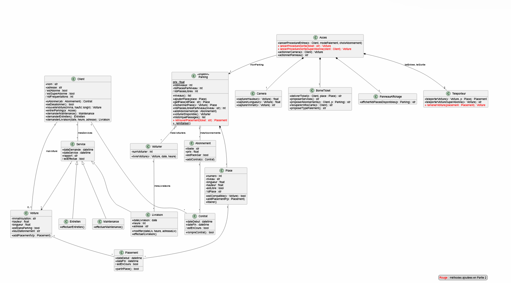

# Projet DreamPark : Partie 2

## Réalisation du use case « Reprendre la voiture »

**Équipe :** 404 Places Not Found  
**Membres :** Ayachi Mohamed Ramzi (modèle), Japhet KOYAKOSSO ESSO (tests)  
**Formation :** L3 MIASHS, parcours Informatique et SHS  
**Université Toulouse 2 Jean-Jaurès**

---

## 1. Ce que fait cette partie

Dans cette partie on a réalisé le use case « Reprendre la voiture ». Le client arrive à un accès et donne son ticket (par exemple A1-AB123CD-0930, qui contient la place et la plaque). Le parking retrouve le placement correspondant, le téléporteur de sortie ramène la voiture et libère la place, puis le panneau d'affichage se met à jour.

Si le ticket ne correspond à rien (ticket inventé ou voiture déjà sortie), on ne rend rien et aucune place n'est libérée. Le super-abonné n'a pas de ticket : on lui rend sa voiture qu'elle soit chez nous ou dans le parking partenaire.

On a aussi ajouté au menu les services pour les abonnés (maintenance, entretien, livraison) et la modification d'une livraison.

## 2. Ce qui a été fait

| Dossier | Contenu |
|---|---|
| modele/ | 4 nouvelles méthodes pour la sortie (voir section 5) |
| tests/ | 32 tests réactivés et nouveau fichier test_sortie.py |
| vue/ | Menu à 8 choix, saisie d'une date |
| controleur/ | Sortie, demande de service, modification de livraison |
| main.py | 3 nouvelles actions de menu |

## 3. Le menu console

```
1. Nouveau client
2. Se garer
3. S'abonner
4. Reprendre ma voiture
5. Demander un service
6. Modifier une livraison
7. Voir l'état du parking
8. Voir les clients
0. Quitter
```

Pour reprendre sa voiture, on choisit l'accès puis on tape son ticket (pas besoin pour un super-abonné). On a ajouté une vérification dans le contrôleur : le ticket doit correspondre à la voiture du client, sinon un client pourrait récupérer la voiture d'un autre.

Les services sont réservés aux abonnés. Pour une livraison, l'heure doit être entre 0 et 23 et l'adresse ne doit pas être vide. Comme en Partie 1, les saisies invalides sont redemandées.

## 4. Les tests

Commande :

```
python3 -m unittest discover -s tests -v
```

Résultat : Ran 130 tests, OK (aucun test ignoré).

| Fichier | Ce qui est vérifié |
|---|---|
| test_client.py, test_services.py | Les services et les valeurs limites de l'heure (0 et 23 acceptées, -1 et 24 refusées) |
| test_sortie.py | Retrouver un placement (ticket valide, inconnu, voiture déjà sortie), libération de la place, panneau, ticket invalide, ticket utilisé deux fois, historique conservé, sortie d'un super-abonné (partenaire, DreamPark, pas garé), nbFrequentations après deux passages |

Les tests de test_sortie.py ont été écrits avant le modèle : ils échouaient au début, puis ils passent une fois les méthodes écrites.

## 5. Modifications par rapport aux artefacts de modélisation

| Ajout | Pourquoi |
|---|---|
| Parking.retrouverPlacement(ticket) | C'est le parking qui connaît toutes les places, donc c'est lui qui retrouve le placement à partir du ticket. Renvoie None si le ticket ne correspond à rien |
| Teleporteur.ramenerVoiture(placement) | Le contraire de teleporterVoiture : ramène la voiture et appelle Placement.partirPlace() pour libérer la place |
| Acces.lancerProcedureSortie(ticket) | Le scénario complet : ticket, placement, téléporteur de sortie, mise à jour du panneau |
| Acces.lancerProcedureSortieSuperAbonne(client) | Sans ticket, et la voiture peut être au parking partenaire (donc sans placement) : il faut une procédure à part |
| ControleurParking.sortir, demanderService, modifierLivraison, livraisonEnAttente | MVC : la vue passe par le contrôleur pour les nouvelles actions |
| VueConsole.demanderDate | Saisir la date d'une livraison |



On n'a pas ajouté de classe : les 4 méthodes sont dans des classes qui existaient déjà. Comme en Partie 1, un cas normal (ticket inconnu, voiture pas garée) renvoie None, et seule une erreur de programmation lève une exception.

## 6. Répartition du travail

| Membre | Travail |
|---|---|
| Ayachi Mohamed Ramzi | Les 4 méthodes du modèle, contrôleur, menu, rapport |
| Japhet KOYAKOSSO ESSO | Réactivation des 32 tests, test_sortie.py |
| Les deux | Mise en commun et exécution de tous les tests |

## 7. Suite

La Partie 3 portera sur les statistiques : elle utilisera les placements terminés qu'on garde dans historiquePassages(). La Partie 4 sera l'interface graphique, qui remplacera la vue console sans toucher au modèle.
